# LifeSaver Network

Prototype for blood donor registration, matching, and hospital requests.

## Workflow

1. Donor registers availability.
2. Hospital submits a request.
3. Matcher finds suitable donors.
4. Staff reviews the matches.

## Getting started

Configure database settings through environment variables, install the Python dependencies used by `app.py`, and run the Flask app. Use sample data only.

## License

No new license is granted for contributors’ existing code. Contact the contributors before reuse or relicensing.
